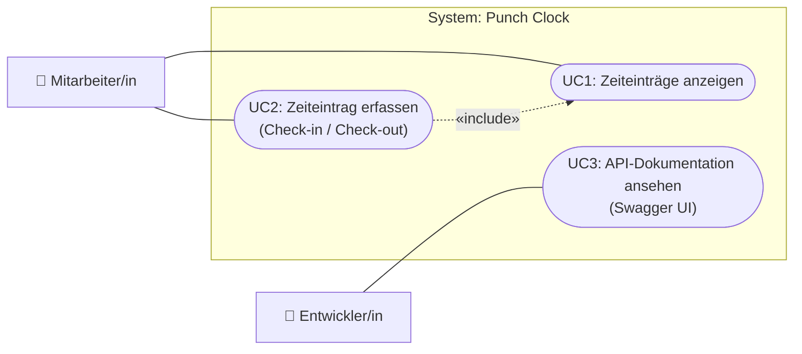
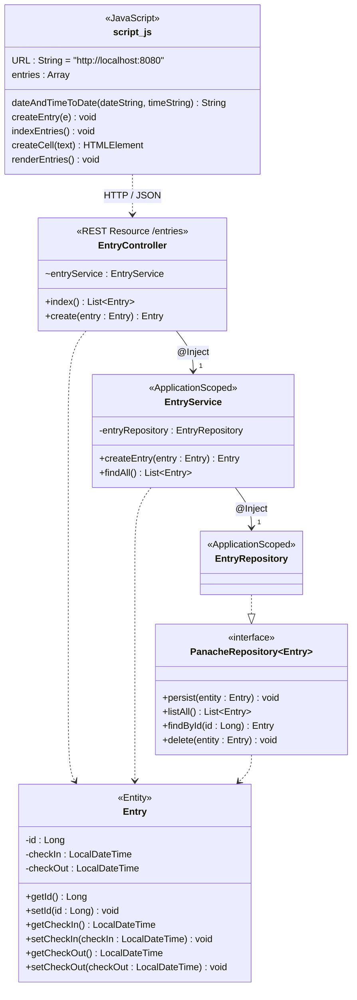
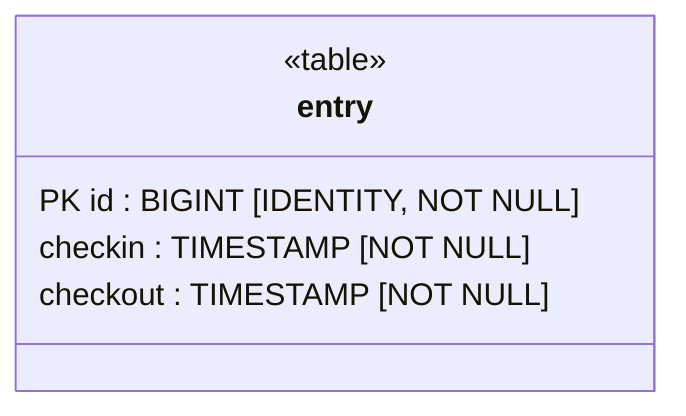
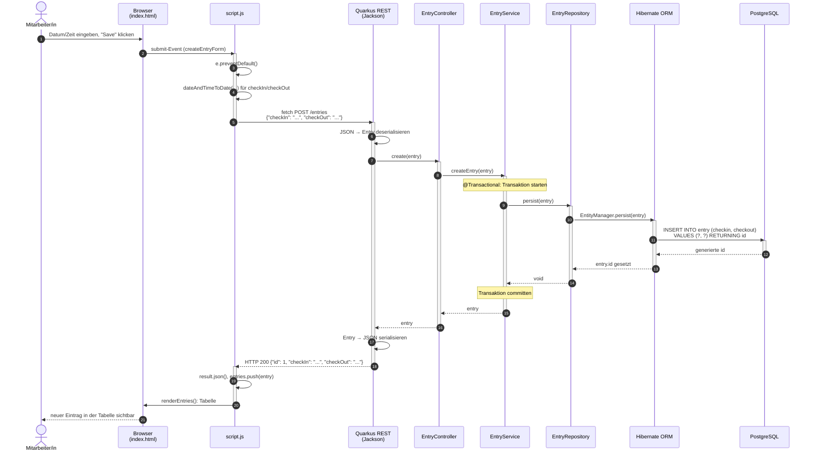
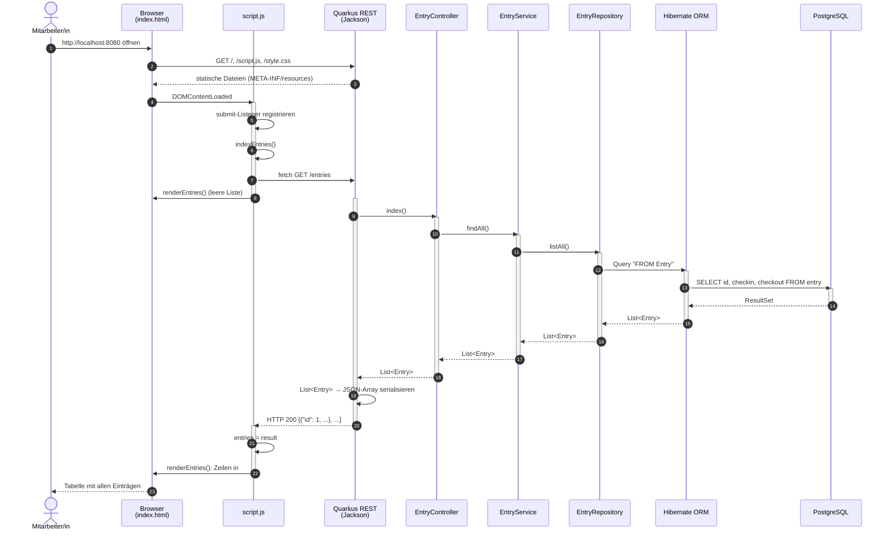

# IST-Analyse Punch Clock

Analyse des aktuellen Stands des Übungsprojekts *Punch Clock* (Quarkus 3.33, Hibernate ORM Panache, PostgreSQL) mit Hilfe von UML-Diagrammen.

Die Diagramme sind in [Mermaid](https://mermaid.js.org/) geschrieben und werden auf GitHub sowie in VS Code (mit Mermaid-Erweiterung) direkt dargestellt.

## Übersicht der Applikation

| Schicht | Artefakt | Aufgabe |
|---|---|---|
| Client (Browser) | [index.html](../src/main/resources/META-INF/resources/index.html), [script.js](../src/main/resources/META-INF/resources/script.js) | Formular zum Erfassen, Tabelle zum Anzeigen der Einträge |
| REST-Schnittstelle | [EntryController](../src/main/java/ch/zli/m223/controller/EntryController.java) | `GET /entries`, `POST /entries` |
| Geschäftslogik | [EntryService](../src/main/java/ch/zli/m223/service/EntryService.java) | Transaktionen, Weiterleitung an Repository |
| Datenzugriff | [EntryRepository](../src/main/java/ch/zli/m223/repository/EntryRepository.java) | Panache-Repository für `Entry` |
| Modell | [Entry](../src/main/java/ch/zli/m223/model/Entry.java) | JPA-Entität (Tabelle `entry`) |
| Datenbank | PostgreSQL 18 (Dev-Container) | Persistenz |

## 1. Anwendungsfalldiagramm

Mermaid kennt keinen eigenen Use-Case-Diagrammtyp. Das Diagramm ist deshalb als Flowchart in UML-Notation umgesetzt (Akteure links, Anwendungsfälle als Ellipsen innerhalb der Systemgrenze).



| Anwendungsfall | Akteur | Beschreibung |
|---|---|---|
| UC1: Zeiteinträge anzeigen | Mitarbeiter/in | Beim Laden der Seite werden alle Einträge (ID, Check-in, Check-out) in einer Tabelle angezeigt. |
| UC2: Zeiteintrag erfassen | Mitarbeiter/in | Datum und Zeit für Check-in und Check-out eingeben und speichern. Danach wird die Tabelle aktualisiert (UC1). |
| UC3: API-Dokumentation ansehen | Entwickler/in | Die REST-Schnittstelle unter `/q/swagger-ui/` ansehen und ausprobieren. |

Nicht vorhanden (IST): Anmeldung/Benutzerverwaltung, Einträge bearbeiten oder löschen, Auswertungen.

## 2. Klassendiagramm



Hinweise:

- `script.js` ist keine Klasse, sondern ein Skript mit globalen Variablen und Funktionen. Es ist zur Vollständigkeit als Klasse mit Stereotyp `«JavaScript»` dargestellt.
- `PanacheRepository<Entry>` stammt aus Quarkus; es sind nur die relevanten der geerbten Methoden aufgeführt. `EntryRepository` selbst definiert keine eigenen Methoden.

## 3. Entity Relationship Diagram (als UML-Klassendiagramm)

Hibernate erzeugt das Schema automatisch aus der Entität `Entry` (`quarkus.hibernate-orm.schema-management.strategy=update`). Da Hibernate die Namen nicht quotiert, legt PostgreSQL Tabellen- und Spaltennamen in Kleinbuchstaben an:

```sql
create table entry (
    id       bigint generated by default as identity,
    checkin  timestamp(6) not null,
    checkout timestamp(6) not null,
    primary key (id)
);
```



| Spalte | Datentyp | Constraints | Java-Attribut |
|---|---|---|---|
| `id` | `bigint` | Primärschlüssel, `generated by default as identity` | `Entry.id : Long` |
| `checkin` | `timestamp(6) without time zone` | `not null` | `Entry.checkIn : LocalDateTime` |
| `checkout` | `timestamp(6) without time zone` | `not null` | `Entry.checkOut : LocalDateTime` |

Im IST-Zustand existiert nur eine Tabelle; es gibt daher keine Beziehungen (Fremdschlüssel). Das Schema lässt sich in pgAdmin (http://localhost:5050, siehe [README.md](../README.md#datenbankadministration)) unter *Servers → db → Databases → postgres → Schemas → public → Tables → entry* überprüfen.

## 4. Sequenzdiagramme

### 4.1 UC2: Zeiteintrag erfassen



### 4.2 UC1: Zeiteinträge anzeigen



## 5. Beobachtungen zum IST-Zustand

- **Keine Benutzer:** Einträge sind keiner Person zugeordnet, es gibt keine Anmeldung.
- **Nur Lesen und Erstellen:** Es gibt weder Bearbeiten noch Löschen (Controller kennt nur `GET` und `POST`).
- **Keine Validierung:** Es wird nicht geprüft, ob `checkOut` nach `checkIn` liegt.
- **Zeitzonen:** Der Client sendet UTC-Zeitstempel (`toISOString()`), gespeichert wird aber `LocalDateTime` bzw. `timestamp without time zone`. Die Zeitzoneninformation geht dadurch verloren und angezeigte Zeiten können verschoben sein.
- **Fehlerbehandlung:** `script.js` behandelt keine Fehlerantworten des Servers; die Server-URL ist fest auf `http://localhost:8080` gesetzt.
